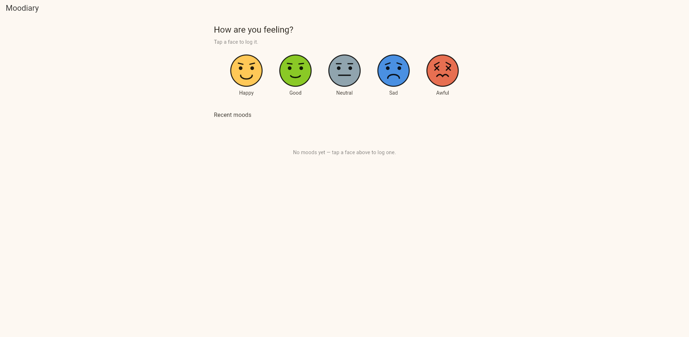
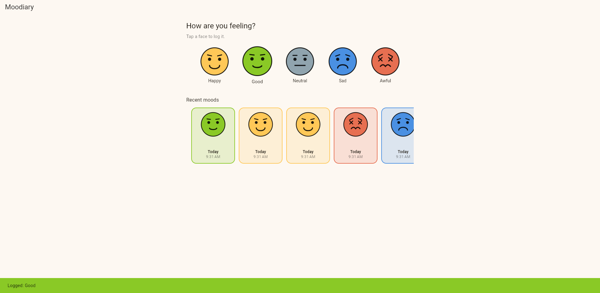

# Moodiary

A simple, cheerful Flutter app for logging how you feel. Tap a face to record your mood, answer a quick reflection prompt, tag what triggered it — and watch your patterns emerge in the journal and trends views.

## Features

- Five expressive moods — Happy, Good, Neutral, Sad, Awful — each rendered with a custom `CustomPainter` face (no image assets required).
- Mood logging flow: pick a mood, optionally answer a mindfulness prompt, tag mood triggers, and add a note — with an instant confirmation snackbar.
- **Mood triggers** — tag entries with life factors (sleep, exercise, weather, work, people, and more) and see which ones show up most in your logs.
- **Trends & insights** — most common mood, happiness score, logging streaks, mood distribution, day-of-week patterns, and a trigger breakdown.
- **Journal** — all entries grouped by day, each card showing the mood face, label, note, and time.
- **Weekly recap** — a "Your Week at a Glance" card summarizing the last 7 days (dominant mood, happiness, top trigger, mood mix, best/hardest day) that you can copy or share as text.
- **Mood forecast** — a "Today's forecast" gauge on the Log tab that predicts today's likely mood from recent momentum, your most common trigger, and time of day, with a plain-language reason and confidence level.
- **Logging goals** — set a daily or weekly check-in target, track progress with a ring on the Log tab, and get a gentle, dismissable in-app nudge when you haven't logged today.
- **Trigger insights** — on-device pattern detection in the Journal tab that surfaces your strongest personal levers, e.g. "Days you tagged Sleep lift your mood," with a strength meter.
- **Mood recovery patterns** — a transition grid in the Journal tab showing how your mood usually flows from one day to the next (e.g. "After Awful, you usually recover to Good"), highlighting resilience.
- **Journal search & filters** — a search box plus mood/date filter chips in the Journal tab, so you can find a specific past entry by note, response, mood, or time range.
- **Streaks & highlights** — a "Your Highlights" card in the Journal tab celebrating your all-time longest streak, your 5 happiest days (with their notes and triggers), and your day-1 milestone.
- **Local persistence** — entries, notes, and triggers are saved with `shared_preferences`, so your history survives app restarts.
- Horizontal timeline of recent moods, color-coded by feeling and timestamped with `intl`.
- State managed with [Riverpod](https://pub.dev/packages/flutter_riverpod) (`ProviderScope` + `StateNotifier`).
- Material 3 theme with a warm, paper-like background.
- Runs on Android, iOS, Web, Windows, macOS, and Linux.

## Screenshots

| Empty state                                  | After logging moods                                    |
| -------------------------------------------- | ------------------------------------------------------ |
|  |  |

## Project structure

```
lib/
├── main.dart                      # App entry point, theme, ProviderScope
├── models/
│   ├── mood.dart                  # Mood enum + MoodEntry model
│   ├── trigger.dart               # Trigger enum (mood trigger categories)
│   ├── goal.dart                  # Logging goal (daily/weekly target)
│   └── mood_entry_serializers.dart# JSON encode/decode for persistence
├── state/
│   ├── mood_entries_provider.dart # Riverpod StateNotifier for entries (+ persistence)
│   ├── mood_prompts_provider.dart # Reflection prompts per mood + weekly prompt
│   ├── mood_trends_provider.dart  # Computed trends (distribution, streaks, triggers)
│   ├── weekly_recap_provider.dart # 7-day recap: dominant mood, top trigger, best/worst day
│   ├── mood_forecast_provider.dart# Today's mood forecast (momentum + triggers + time of day)
│   ├── goals_provider.dart        # Daily/weekly logging goal + nudge state (persisted)
│   ├── insights_provider.dart     # On-device trigger insights (personal patterns)
│   ├── recovery_provider.dart     # Mood->mood recovery patterns (transitions)
│   ├── journal_filter_provider.dart # Journal search + mood/date filter state
│   └── highlights_provider.dart   # Longest streak, top 5 happiest days, day-1
├── screens/
│   ├── mood_home_screen.dart      # Tabbed main screen (Log / Timeline / Journal)
│   └── mood_journal_screen.dart   # Journal tab — weekly recap + entries grouped by day
└── widgets/
    ├── mood_face.dart             # Reusable mood face widget
    ├── mood_face_painter.dart     # CustomPainter that draws each face
    ├── mood_picker.dart           # Mood faces + prompt/trigger/note dialog flow
    ├── mood_timeline.dart         # Horizontal list of recent entries
    ├── mood_trends_chart.dart     # Trends: summary, streaks, distribution, triggers
    ├── mood_entry_edit_dialog.dart# Edit an existing entry (mood, note, triggers)
    ├── weekly_recap_card.dart     # "Your Week at a Glance" card with copy/share
    ├── mood_forecast_card.dart    # "Today's forecast" gauge with contributing factors
    ├── goal_progress_card.dart    # Progress ring + goal settings dialog
    ├── mood_nudge_banner.dart     # Gentle in-app "log your mood" nudge
    ├── trigger_insights_card.dart # "Your Patterns" — strongest personal insights
    ├── mood_recovery_card.dart    # "Mood Recovery Patterns" — transition grid
    ├── journal_filter_bar.dart    # Search + mood/date filter chips
    └── highlights_card.dart       # "Your Highlights" — streak + happiest days
```

## Getting started

Prerequisites:

- Flutter SDK (Dart `^3.11.5`)
- A configured target device (emulator, simulator, browser, or desktop)

Install dependencies and run:

```bash
flutter pub get
flutter run
```

To run on a specific platform:

```bash
flutter run -d chrome     # Web
flutter run -d windows    # Windows desktop
flutter run -d macos      # macOS desktop
```

Run the test suite:

```bash
flutter test
```

## Generating launcher icons

App icons are configured via [`flutter_launcher_icons`](https://pub.dev/packages/flutter_launcher_icons) using `assets/icon/moodiary.webp`. To regenerate:

```bash
flutter pub run flutter_launcher_icons
```

## Tech stack

- **Flutter** + **Material 3**
- **flutter_riverpod** for state management
- **intl** for date/time formatting
- **collection** for trend calculations
- **shared_preferences** for local persistence
- **share_plus** for exporting the weekly recap
- **CustomPainter** for the mood faces

## Building for iOS

### Prerequisites

To build and run Moodiary on iOS, you need:

- A Mac running macOS.
- [Flutter SDK](https://docs.flutter.dev/get-started/install).
- [Xcode](https://developer.apple.com/xcode/) installed with the required iOS SDK.
- CocoaPods, if required by your Flutter plugins.
- An iOS simulator or a physical iPhone.

> **Note:** Building an iOS app requires macOS and Xcode. You cannot build an iOS app directly on Windows or Linux using the standard Flutter toolchain.

### 1. Install dependencies

From the project root, run:

```bash
flutter pub get
```

### 2. Check the iOS setup

Verify that Flutter can detect your iOS development environment:

```bash
flutter doctor
```

Resolve any reported Xcode or iOS toolchain issues before continuing.

### 3. Run on the iOS simulator

List the available simulators:

```bash
flutter devices
```

Open the iOS Simulator if necessary:

```bash
open -a Simulator
```

Run Moodiary:

```bash
flutter run -d ios
```

Alternatively, select a specific simulator from the devices listed by Flutter.

### 4. Build for iOS

To create a release build for distribution or testing, run:

```bash
flutter build ios --release
```

This generates the iOS build using the configuration in `ios/Runner.xcodeproj`.

For a physical iPhone or App Store distribution, configure code signing in Xcode:

1. Open `ios/Runner.xcworkspace` in Xcode.
2. Select the **Runner** target.
3. Under **Signing & Capabilities**, select your development team.
4. Ensure the bundle identifier is unique and configure automatic signing if appropriate.
5. Select the desired iOS device or build destination.

### 5. Create an IPA for distribution

To build an IPA package, run:

```bash
flutter build ipa --release
```

Flutter generates the archive and IPA, when successfully exportable, under:

```text
build/ios/archive/
build/ios/ipa/
```

You can use the resulting IPA for supported distribution workflows, such as TestFlight or App Store Connect. Distribution requires the appropriate Apple signing credentials and provisioning configuration.

### Useful commands

```bash
# Run on an iOS simulator or connected device
flutter run -d ios

# Build a release version
flutter build ios --release

# Build an IPA for distribution
flutter build ipa --release

# Clean generated build files
flutter clean
flutter pub get
```

For more details, see the official [Flutter iOS deployment guide](https://docs.flutter.dev/deployment/ios).

## Building for Android (APK)

### Prerequisites

To build Moodiary for Android, you need:

- [Flutter SDK](https://docs.flutter.dev/get-started/install) installed and configured.
- [Android Studio](https://developer.android.com/studio) with the Android SDK.
- An Android emulator or a physical Android device.

### 1. Install dependencies

From the project root, run:

```bash
flutter pub get
```

### 2. Check your Android setup

Verify that Flutter and the Android toolchain are configured correctly:

```bash
flutter doctor
```

Resolve any reported Android SDK or license issues. If necessary, accept the Android SDK licenses:

```bash
flutter doctor --android-licenses
```

### 3. Run on an Android device

List available devices:

```bash
flutter devices
```

Run Moodiary on a connected device or emulator:

```bash
flutter run
```

### 4. Build a release APK

To generate a release APK, run:

```bash
flutter build apk --release
```

The APK will be generated at:

```text
build/app/outputs/flutter-apk/app-release.apk
```

You can transfer this file to an Android device and install it.

### 5. Build smaller APKs for specific architectures (optional)

To generate separate APKs for supported CPU architectures, run:

```bash
flutter build apk --split-per-abi
```

This generates architecture-specific APKs in:

```text
build/app/outputs/flutter-apk/
```

For example:

- `app-armeabi-v7a-release.apk`
- `app-arm64-v8a-release.apk`
- `app-x86_64-release.apk`

These APKs are smaller than a universal APK because each targets a specific CPU architecture. For most modern Android phones, the `arm64-v8a` version is appropriate.

### 6. Install the APK (optional)

With an Android device connected and USB debugging enabled, install the release APK using:

```bash
flutter install
```

Alternatively, copy `app-release.apk` to your phone and open it. You may need to allow installation from that source in your Android settings.

### Useful commands

```bash
# Run the app
flutter run

# Build a release APK
flutter build apk --release

# Build APKs for individual CPU architectures
flutter build apk --split-per-abi

# Install on a connected device
flutter install

# Clean and rebuild
flutter clean
flutter pub get
flutter build apk --release
```

For more details, see the official [Flutter Android deployment guide](https://docs.flutter.dev/deployment/android).
