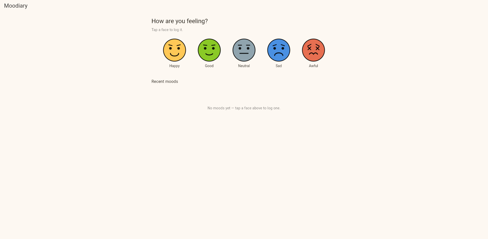
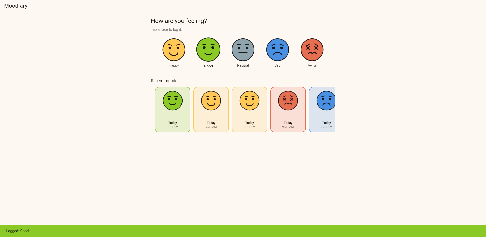

# Moodiary

A simple, cheerful Flutter app for logging how you feel. Tap a face to record your mood and watch your recent entries appear in a horizontal timeline.

## Features

- Five expressive moods — Happy, Good, Neutral, Sad, Awful — each rendered with a custom `CustomPainter` face (no image assets required).
- One-tap mood logging with an instant confirmation snackbar.
- Horizontal timeline of recent moods, color-coded by feeling and timestamped with `intl`.
- State managed with [Riverpod](https://pub.dev/packages/flutter_riverpod) (`ProviderScope` + `StateNotifier`).
- Material 3 theme with a warm, paper-like background.
- Runs on Android, iOS, Web, Windows, macOS, and Linux.

## Screenshots

| Empty state | After logging moods |
| --- | --- |
|  |  |

## Project structure

```
lib/
├── main.dart                      # App entry point, theme, ProviderScope
├── models/
│   └── mood.dart                  # Mood enum + MoodEntry model
├── state/
│   └── mood_entries_provider.dart # Riverpod StateNotifier for entries
├── screens/
│   └── mood_home_screen.dart      # Main screen layout
└── widgets/
    ├── mood_face.dart             # Reusable mood face widget
    ├── mood_face_painter.dart     # CustomPainter that draws each face
    ├── mood_picker.dart           # Row of tappable mood faces
    └── mood_timeline.dart         # Horizontal list of recent entries
```

## Getting started

Prerequisites:

- Flutter SDK (Dart `^3.11.5`)
- A configured target device (emulator, simulator, browser, or desktop)

Install dependencies and run:

```bash
flutter pub get
flutter run
```

To run on a specific platform:

```bash
flutter run -d chrome     # Web
flutter run -d windows    # Windows desktop
flutter run -d macos      # macOS desktop
```

## Generating launcher icons

App icons are configured via [`flutter_launcher_icons`](https://pub.dev/packages/flutter_launcher_icons) using `assets/icon/moodiary.webp`. To regenerate:

```bash
flutter pub run flutter_launcher_icons
```

## Tech stack

- **Flutter** + **Material**
- **flutter_riverpod** for state management
- **intl** for date/time formatting
- **CustomPainter** for the mood faces


## Building for iOS

### Prerequisites

To build and run Moodiary on iOS, you need:

- A Mac running macOS.
- [Flutter SDK](https://docs.flutter.dev/get-started/install).
- [Xcode](https://developer.apple.com/xcode/) installed with the required iOS SDK.
- CocoaPods, if required by your Flutter plugins.
- An iOS simulator or a physical iPhone.

> **Note:** Building an iOS app requires macOS and Xcode. You cannot build an iOS app directly on Windows or Linux using the standard Flutter toolchain.

### 1. Install dependencies

From the project root, run:

```bash
flutter pub get
```

### 2. Check the iOS setup

Verify that Flutter can detect your iOS development environment:

```bash
flutter doctor
```

Resolve any reported Xcode or iOS toolchain issues before continuing.

### 3. Run on the iOS simulator

List the available simulators:

```bash
flutter devices
```

Open the iOS Simulator if necessary:

```bash
open -a Simulator
```

Run Moodiary:

```bash
flutter run -d ios
```

Alternatively, select a specific simulator from the devices listed by Flutter.

### 4. Build for iOS

To create a release build for distribution or testing, run:

```bash
flutter build ios --release
```

This generates the iOS build using the configuration in `ios/Runner.xcodeproj`.

For a physical iPhone or App Store distribution, configure code signing in Xcode:

1. Open `ios/Runner.xcworkspace` in Xcode.
2. Select the **Runner** target.
3. Under **Signing & Capabilities**, select your development team.
4. Ensure the bundle identifier is unique and configure automatic signing if appropriate.
5. Select the desired iOS device or build destination.

### 5. Create an IPA for distribution

To build an IPA package, run:

```bash
flutter build ipa --release
```

Flutter generates the archive and IPA, when successfully exportable, under:

```text
build/ios/archive/
build/ios/ipa/
```

You can use the resulting IPA for supported distribution workflows, such as TestFlight or App Store Connect. Distribution requires the appropriate Apple signing credentials and provisioning configuration.

### Useful commands

```bash
# Run on an iOS simulator or connected device
flutter run -d ios

# Build a release version
flutter build ios --release

# Build an IPA for distribution
flutter build ipa --release

# Clean generated build files
flutter clean
flutter pub get
```

For more details, see the official [Flutter iOS deployment guide](https://docs.flutter.dev/deployment/ios).